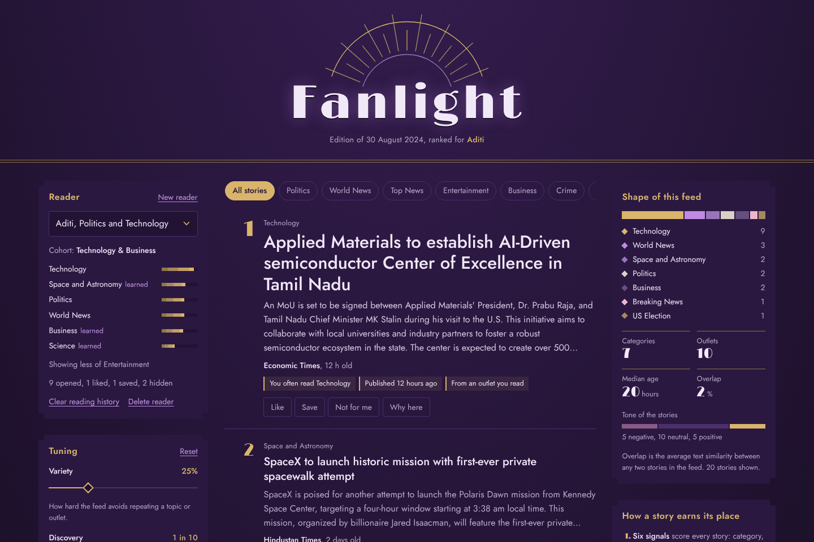
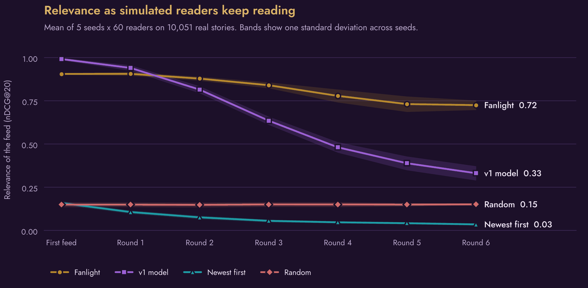
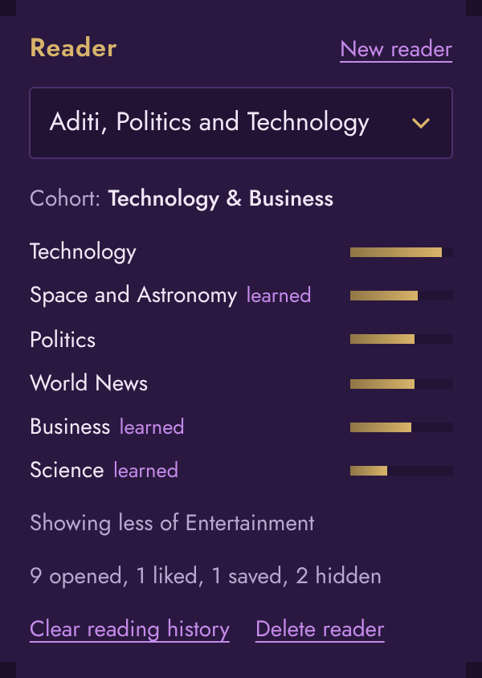
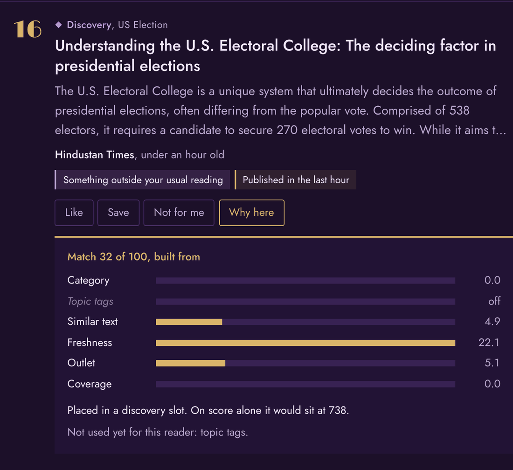
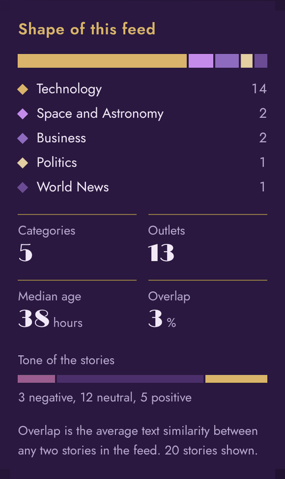
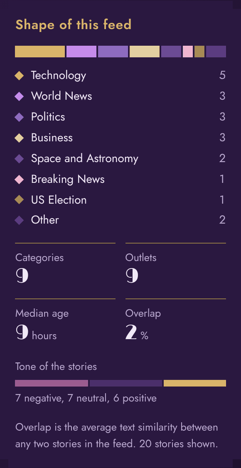
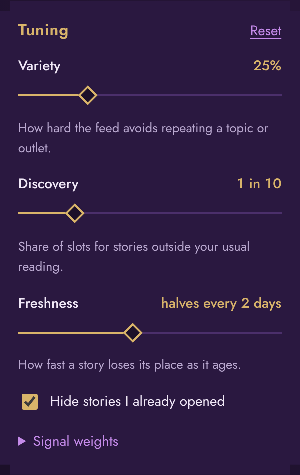
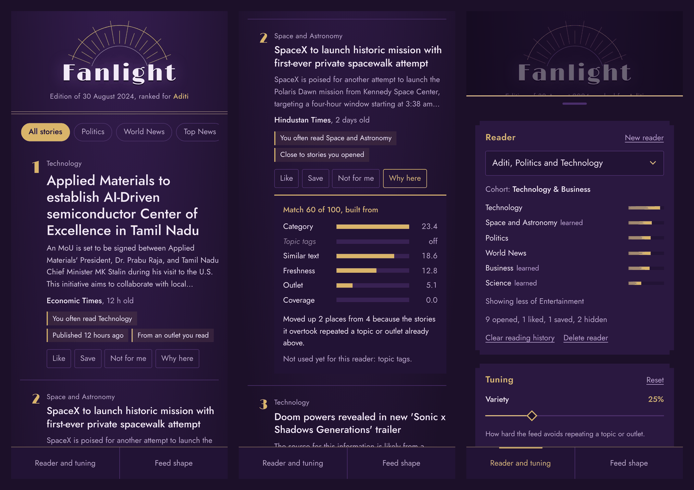

<p align="center">
  
</p>

<p align="center">
  <b>A personalised news feed that shows its working.</b><br>
  Today's news from 20 feeds in English and Hindi, ranked for each reader. Every story says why it is there, the feed learns from what you read and keeps some room for what you don't.<br>
  In a simulation of 60 readers on 10,051 real stories, it is still serving relevant stories after six rounds (0.72, mean of five seeds), where the trained v1 model falls to 0.33. <a href="#results">How it is measured</a>
</p>

<p align="center">
  
  
  
  
  
</p>

<p align="center">
  
</p>

A fanlight is the half-round window over an art-deco door, with bars fanning out like sunrays. It lets light into the room. That is the idea here: a recommender you can see into, rather than a black box that decides what you read.

## Results

There is no click log for the dataset, so `fanlight evaluate` simulates readers. Each has a hidden taste of two to four categories and tells the ranker only one, then reacts to six feeds in a row. Every number below is the mean of five seeds, with one standard deviation across seeds after the ±.

<p align="center"></p>

| 10,051 real stories, 60 readers, 5 seeds | Relevance, first feed | Relevance after six rounds | Opens per reader | Unstated interests found | Median story age |
| --- | ---: | ---: | ---: | ---: | ---: |
| **Fanlight** | 0.91 ± 0.00 | **0.72 ± 0.03** | 55.8 ± 0.8 | **41% ± 2** | 5 days |
| Fanlight, variety and discovery off | 1.00 ± 0.00 | 0.73 ± 0.05 | 59.0 ± 0.9 | 30% ± 4 | 5 days |
| v1 (trained XGBoost model) | 0.99 ± 0.01 | 0.33 ± 0.04 | 48.2 ± 1.4 | 5% ± 2 | 36 days |
| Newest first | 0.16 ± 0.01 | 0.03 ± 0.01 | 5.9 ± 0.6 | 29% ± 2 | 9 hours |
| Random, last 14 days | 0.15 ± 0.01 | 0.15 ± 0.01 | 10.5 ± 0.3 | 69% ± 7 | 7 days |

v1 matched the stated category well on day one but never learned, so after six rounds it was serving stories more than a month old and had surfaced almost none of the interests readers kept to themselves. Variety and discovery cost about 5% of opens and raise unstated interests found from 30% to 41%; on relevance after six rounds the two Fanlight variants are within noise of each other. The text index is checked on its own as well: 58% of a story's ten nearest neighbours share its category, against 9% by chance.

### How the simulation is built

- **Readers.** 60 per seed. Each gets two to four categories with strengths 1.0, 0.7, 0.5 and 0.35, drawn from categories with at least 25 stories in the reader's language in the last 14 days, and tells the ranker only the strongest one. Languages are drawn in proportion to the corpus.
- **Behaviour.** The reader acts on six 20-story feeds, and the seventh, built from everything it did, is the one scored as "after six rounds". The reader looks at slot *p* with probability 0.95<sup>*p*−1</sup>, opens a story it looks at with probability 0.9 × its relevance, hides an irrelevant one with probability 0.1, and every story it looks at is logged as an impression.
- **Ground truth.** The dataset's editorial category labels, never the text features the ranker sees, so the ranker can't grade its own work. Anything older than 14 days or in another language counts as irrelevant.
- **Metrics.** *Relevance* is nDCG@20 with graded gains: a story's gain is the reader's hidden strength for its best-matching category, DCG sums gain / log<sub>2</sub>(position + 1), and the ideal is the best 20-story feed that could still be built from stories the reader hasn't opened, liked, saved or hidden. *Unstated interests found* is the share of the categories the reader never stated that appear at least once in that seventh feed. *Opens per reader* is the total across the six feeds the reader acts on. *Median story age* is for the same feed, measured from the newest story in the dataset.
- **Baselines.** v1's original `trained_model.pkl`, scored on the four features v1 built (reader language, language match, stated-category overlap, story age), with age counted from the newest story rather than the wall clock, which is the kindest reading of v1. Then newest first, random from the last 14 days and Fanlight with variety and discovery off. Every policy faces the same readers, each with the same random seed.

### Reproduce it

```bash
pip install xgboost                                         # only for the v1 baseline
fanlight evaluate --v1-model trained_model.pkl --seeds 5    # the table and chart: seeds 0 to 4
fanlight evaluate --v1-model trained_model.pkl              # one run, seed 0
fanlight evaluate --demo                                    # synthetic newsroom, no data needed
```

The first three need the dataset export in `data/`, and `--v1-model` needs v1's `trained_model.pkl`; without it, v1 is stood in for by the formula its training labels were generated from. A seed always gives the same numbers. On a 2-core cloud VM one seed takes about 30 seconds and five about 2.5 minutes, plus about 20 seconds to build the index the first time.

### What this can't tell you

- The simulated readers want categories, and Fanlight has a category signal, so the setup favours a ranker that tracks categories. It shows the ranker learns and doesn't go stale. It doesn't show that real readers would prefer it.
- Random finds the most unstated interests (69%) because it spreads across every category, and its relevance is near zero (0.15). That column only means something next to relevance.
- Single runs mislead. Seed 0 happened to be Fanlight's best seed (0.75) and v1's worst (0.27); over five seeds it is 0.72 ± 0.03 against 0.33 ± 0.04. Five seeds is still a small sample for estimating the spread.
- Simulated readers are a sanity check, not a replacement for an A/B test. Every interaction the app records lands in an event log, which is the data that test would need.

## Read today's news

```bash
pip install git+https://github.com/AdityaT26/fanlight.git
fanlight serve --source live
```

Open <http://127.0.0.1:8000>, pick a language and a few topics, and the feed is ready. Fanlight polls 20 publisher feeds every 15 minutes, keeps two weeks of stories, rebuilds its index in the background and offers new stories with a "New stories are in" prompt instead of reshuffling the page while you read.

| Language | Outlets in the default list |
| --- | --- |
| English | The Hindu (national, business, science and tech, sport), The Indian Express, Hindustan Times, BBC News (world, technology, science, business), The Guardian (world, film, sport), Al Jazeera, Ars Technica, ESPNcricinfo |
| Hindi | BBC Hindi, Aaj Tak, ABP Live, Amar Ujala |

Each feed has a default category; a story's own tags and the section in its URL refine it, so a cricket report in a general Hindi feed usually lands in Cricket rather than Top News. Fanlight shows only what a feed reader shows (headline, the feed's own summary, its image) and every headline links to the publisher. The list lives in [`fanlight/feeds.toml`](fanlight/feeds.toml): copy it, add or remove feeds and point `FANLIGHT_FEEDS` at your copy. `fanlight feeds` shows which ones are healthy.

**Running it for other people.** `--public` (on by default in the Docker image) makes each browser private: nobody can list readers, a reader's long random id is its key, and the browser remembers the readers it created. There are no accounts or passwords, so treat it as a personal reading tool you can share, not a service holding anything sensitive. Check each publisher's feed terms before you put a public service on top of their feeds.

## What it does

### Every story explains itself

Each story carries up to three plain reasons ("You often read Technology", "Reported by 2 outlets"). **Why here** opens the full breakdown: how much each of the six signals added to the score, which signals are still sitting out for this reader, where the story would rank on score alone, and the same story as reported by other outlets.

<p align="center"></p>

### It learns what you read

Opening, liking and saving pull a category and its vocabulary up, "Not for me" pushes them down, and scrolling past a story without opening it slowly sinks it. Interests the reader never stated show up as **learned**. Each category saturates on its own, so reading a lot of technology never pushes politics out.

<p align="center"></p>

### It doesn't only echo you

One slot in ten goes to a discovery pick: a fresh, well-covered story from a category the reader hasn't touched, rotating towards the ones they have seen least. The rest of the feed spaces out repeats, so the same topic or outlet doesn't fill five slots in a row, and one event reported by five outlets takes one slot.

<p align="center"></p>

The **Variety** dial makes the trade-off visible. The same reader, same moment:

| Variety 0%, no discovery | Variety 100%, discovery 1 in 5 |
| :---: | :---: |
|  |  |

### You hold the dials

Variety, discovery, how fast stories age and the weight of every signal are sliders, and the feed re-ranks as you drag. The same knobs are query parameters on the API.

<p align="center"></p>

### English and Hindi

The text index keeps Devanagari words whole (the usual tokenizers split them at the vowel signs), drops English and Hindi stopwords and only links stories within one language. Headlines are set in Jost with a Devanagari fallback, so both scripts sit well together.

<p align="center"></p>

### Built for the phone too

On small screens the feed goes single column and the reader, tuning and feed-shape panels become bottom sheets.

<p align="center"></p>

## Quick start

```bash
git clone https://github.com/AdityaT26/fanlight.git && cd fanlight
python -m venv .venv && source .venv/bin/activate   # Windows: .venv\Scripts\activate
pip install -e ".[dev]"

fanlight serve --demo        # a synthetic newsroom, no data needed
```

Open <http://127.0.0.1:8000>. Run `fanlight serve --source live` for today's news, or put the JSON export in `data/` (or point `FANLIGHT_DATA_DIR` at it) and run `fanlight serve` to rank the dataset. The first start builds the index, about 20 seconds for 10,000 articles, and caches it in `var/`; after that it starts in under a second.

With Docker, live news in public mode out of the box:

```bash
docker build -t fanlight .
docker run -p 8000:8000 -v fanlight-state:/app/var fanlight
```

The volume keeps readers, their history and fetched stories across restarts. Add `--source json` and mount the dataset at `/app/data` to serve the dataset instead.

## How a story earns its place

```
 export ─▶ ingest ─▶ index ─────────────▶ signals ─▶ fusion ─▶ selection ─▶ feed + reasons
          (clean,    (TF-IDF, stories,     ▲                    (variety,
           dedupe)    outlet reach)        │                     discovery)
                                     reader state ◀── opens, likes, saves, hides, impressions
```

1. **Ingest.** Live mode fetches RSS and Atom feeds with conditional requests, so an unchanged feed costs one 304. The MongoDB export arrives with ids in several shapes, five date formats, three overlapping tag collections, duplicate categories, soft-deleted rows and re-ingested duplicates. All of it is normalised into typed articles.
2. **Index.** Bilingual TF-IDF over headline and body. Reports of one event from different outlets are grouped into a story: cosine of at least 0.5, same language, within 72 hours, with a stricter 0.85 for two pieces from the same outlet, whose page templates make unrelated articles look alike.
3. **Reader state.** Stated interests and behaviour become an affinity per category between -1 and 1. Evidence is log-damped and fades with a 21-day half-life. Opened stories also form a text taste vector that is trusted more as evidence builds.
4. **Six signals.** Category, topic tags, similar text, freshness (a fast and a slow decay), outlet (reach plus the reader's favourites) and coverage (outlets per story plus engagement). A signal with nothing to say for this reader sits out and its weight goes to the others.
5. **Selection.** The feed is filled slot by slot: score minus redundancy with what is already above it. Discovery slots are filled separately. One article per story.

All the knobs are in [`fanlight/config.py`](fanlight/config.py).

<details>
<summary><b>Data format</b></summary>

The engine reads these collections from `FANLIGHT_DATA_DIR`, as `<name>.json` (an array) or `<name>.jsonl` (as written by `mongoexport`):

| File | Used for |
| --- | --- |
| `articles.json` | Required. Title, body, summary, link, date, language, category, tag and source references, engagement counts |
| `article_categories.json` | Category names; active and inactive duplicates are merged |
| `tag.json`, `tags.json`, `article_tags.json` | Tag names; ids from any of the three resolve |
| `sources.json`, `source.json` | Outlet names and popularity rank |
| `user_preferences.json` | Imported readers: language and stated categories, newest document per user |

To read straight from MongoDB instead: `pip install -e ".[mongo]"`, set `FANLIGHT_MONGO_URI` and pass `--source mongo`. Data, the index cache and the reader database are git-ignored, and imported readers only ever appear under a hashed id.

</details>

<details>
<summary><b>Configuration</b></summary>

Environment variables, or a `.env` file in the working directory (see [`.env.example`](.env.example)):

| Variable | Default | Meaning |
| --- | --- | --- |
| `FANLIGHT_DATA_DIR` | `data` | Folder with the JSON collections |
| `FANLIGHT_STATE_DIR` | `var` | Index cache and the SQLite database of readers and events |
| `FANLIGHT_AS_OF` | `latest` | Feed clock: `latest` (newest story in the data), `now`, or an ISO date |
| `FANLIGHT_MONGO_URI` | unset | MongoDB connection string for `--source mongo` |
| `FANLIGHT_MONGO_DB` | `unbiasly` | Database name |
| `FANLIGHT_COHORTS` | `8` | Number of reader cohorts |
| `FANLIGHT_FEEDS` | packaged list | Feed list for live mode (TOML) |
| `FANLIGHT_REFRESH_MINUTES` | `15` | Minutes between feed refreshes |
| `FANLIGHT_RETENTION_DAYS` | `14` | Days of live stories to keep |
| `FANLIGHT_PUBLIC` | `false` | Browsers only see the readers they created |

In live mode stories are always ranked against the current time. `FANLIGHT_AS_OF=latest` ranks a static export as if it were the moment of its newest story, so freshness still means something months later.

</details>

<details>
<summary><b>Command line</b></summary>

```bash
fanlight serve --source live      # today's news; add --public to share it
fanlight fetch                    # fetch the feeds once (handy from cron)
fanlight feeds                    # which feeds are healthy, which are failing
fanlight index                    # build the index, print corpus statistics and cohorts
fanlight readers                  # list readers
fanlight create-reader Aditi --category politics --category technology
fanlight feed r_1a2b3c4d5e -k 15  # ranked feed with reasons, in the terminal
fanlight feed u_0281362149 --json
fanlight evaluate --seeds 5       # the simulation behind the results above
fanlight demo-data ./demo         # write the synthetic dataset as JSON
fanlight serve --host 0.0.0.0 --port 8000
```

Every data command also takes `--source json|live|mongo`, `--demo` and `--rebuild`.

</details>

<details>
<summary><b>HTTP API</b></summary>

Interactive docs live at `/api/docs` while the server runs.

| Method | Path | |
| --- | --- | --- |
| GET | `/api/meta` | Corpus statistics, categories, signals, defaults, cohorts |
| GET | `/api/readers` | Readers. `?ids=a,b` returns just those; in public mode that is the only way to list any |
| POST | `/api/readers` | Create: `{"name", "languages": [...], "categories": [...]}` |
| GET, PATCH, DELETE | `/api/readers/{id}` | One reader; imported readers are read-only |
| GET | `/api/readers/{id}/feed` | Ranked feed. Query: `k`, `category` (repeatable), `diversity`, `discovery`, `half_life_hours`, `hide_read`, `w_<signal>` |
| POST | `/api/readers/{id}/events` | `{"events": [{"article_id", "action"}]}` with `view`, `open`, `like`, `save` or `hide` |
| DELETE | `/api/readers/{id}/events` | Undo one action |
| DELETE | `/api/readers/{id}/history` | Forget a reader's interactions |
| GET | `/api/articles/{id}` | One article |
| GET | `/api/feeds` | Live mode: each feed's last fetch, errors and story counts |

</details>

## Project layout

```
fanlight/
  feeds.py        fetch and parse RSS and Atom, infer categories
  feeds.toml      the default feed list
  live.py         rolling window of live stories, background refresher
  ingest.py       load JSON or MongoDB, normalise into typed articles
  text.py         bilingual tokenizer and TF-IDF
  index.py        vectors, story clusters, outlet reach, coverage
  profiles.py     readers, interaction evidence, affinities
  ranker.py       signals, fusion, variety re-ranking, discovery slots, reasons
  cohorts.py      k-means reader cohorts with readable labels
  store.py        SQLite readers and event log
  engine.py       wires it together for the CLI and the API
  evaluation.py   simulated readers and baselines
  synth.py        synthetic newsroom for tests and --demo
  api.py, cli.py  FastAPI app and command line
  web/static/     the web app: plain HTML, CSS and JavaScript, fonts self-hosted
tests/            100 tests: live feeds against a local feed server, browser tests at desktop and phone sizes
```

## Development

```bash
pip install -e ".[dev]"
python -m playwright install chromium   # once, for the browser tests
pytest
ruff check . && ruff format --check .
```

Browser tests skip themselves when Chromium is missing; set `FANLIGHT_CHROME` to reuse an installed Chrome.

## From v1 to Fanlight

Fanlight is a ground-up rewrite of my earlier news-ranking-system, which was built on the Unbiasly news dataset. The old version:

- trained XGBoost on labels it generated itself from a formula plus random noise, so the model could at best learn the formula and never saw a reader;
- measured story age against the wall clock, so on a static export every story aged together and freshness stopped mattering;
- used click data for one hard-coded user only, and backwards: more clicks on a category meant a smaller bonus;
- never matched article tags, ranked deleted stories and duplicates, and let one event from five outlets fill five slots;
- min-max scaled each user's scores, so "100/100" meant nothing from one reader to the next.

## Licence

[MIT](LICENSE). The fonts in `fanlight/web/static/fonts` are under the SIL Open Font License. News content belongs to its publishers.
